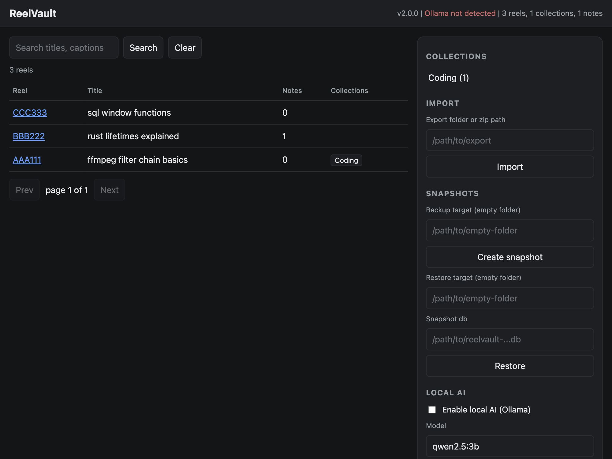
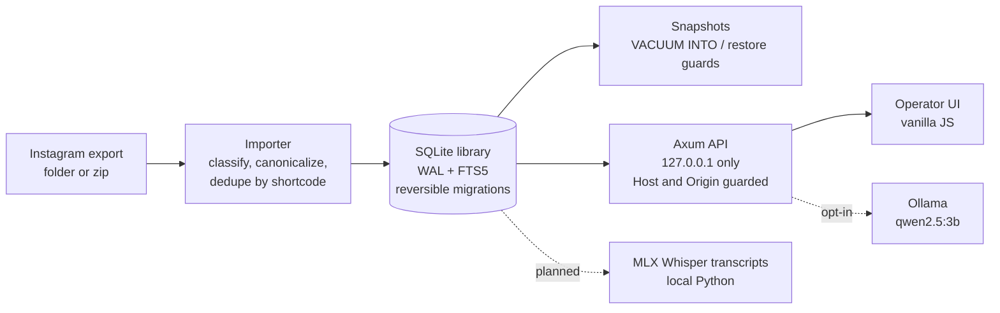

<div align="center">


# Reel Vault

**A local-first, evidence-backed technical library built from Instagram Saved reels.**

Your Saved tab is where useful reels go to disappear. ReelVault turns your
Instagram export file into a real library instead: every entry keeps its original
link, collections survive the trip, and the report never invents a row that the
export does not contain.

<p>
  
  
</p>

<p>
  
  
  
  
</p>
<p>
  
  
  
  
  
</p>

<sub>Badge values are hand-verified from the local baseline run dated 2026-11-10, not CI claims.</sub>

</div>

---

<div align="center">
  
</div>

## What the app does today

1. Pick an Instagram export (folder or zip, the same files Instagram emails you).
2. The importer reads `saved_posts.json`, `saved_collections.json`, and
   `saved_saved_collections.json`, canonicalizes every link, dedupes by shortcode,
   and reports exactly what it saw: new, merged, duplicates, invalid links,
   unknown structures, skipped.
3. Everything lands in a portable SQLite library (WAL mode, FTS5 full-text,
   explicit reindex on every write) at
   `~/Library/Application Support/ReelVault/`.
4. Search titles, captions, and notes in the browser UI at
   `http://127.0.0.1:8423`. Filter by collection, open a drawer with the
   canonical reel link, add and delete notes with a confirmation.
5. Snapshots: backup uses `VACUUM INTO` into an empty folder, restore goes into
   a fresh empty folder, both refuse to overwrite a live library (HTTP 409) and
   both guard the schema version in each direction.
6. Local AI is off by default. The server answers 403 until you opt in from the
   UI, then calls Ollama on your machine. No Ollama? The UI says so instead of
   pretending.

## Progress, out of what

Two headline numbers above are hand-calculated from the equal-weighted status
table below (state on 2026-11-10, Apple Silicon M2, 8 GB).

| Workstream | Status | Detail |
|---|---|---|
| Core: schema, migrations, FTS5, API, security guard, backup/restore |  | Done and test-covered |
| Import engine |  | Three file shapes plus zip; pending validation against your real export |
| Operator UI |  | Works end to end in a real browser; empty-vs-no-match message polish left |
| Ollama local AI |  | Client, gate, and graceful path tested; engine itself not installed on this machine yet |
| MLX transcription |  | `tools/transcribe.py` contract plus Python IO tests; no venv or engine wired yet |
| Real-fixture validation |  | Waiting on a sanitized export from you |

| Workstream | Status | Detail |
|---|---|---|
| Windows 11 parity |  | `LOCALAPPDATA` path branch compiles cross-platform; not runtime-verified |
| Packaging and CI |  | Plain `cargo run`; no DMG, no CI pipeline yet |

Mac engineering is the first five rows averaged: **75%**. Including
real-fixture validation the Mac figure is **63%**. Adding Windows parity and
packaging gives the full V1.0 figure: **48%**. The percentages describe the V1.0
goalpost defined in the roadmap, so they move only when something verified
changes.

## Stack

| Layer | Choice | Why |
|---|---|---|
| Language | Rust (single crate, stable) | One binary, no runtime dependencies |
| HTTP | axum 0.8 + tokio | Request handlers only, no framework magic |
| Database | SQLite via rusqlite (bundled) + FTS5 | Portable single file, zero server |
| Import | serde_json + zip crate | Read-only parsing, zip never extracted to disk |
| AI | Ollama, `qwen2.5:3b` default via hyper-util client | Local and opt-in |
| Transcription | mlx-whisper (planned) via Python 3.11 CLI tool | Apple Neural Engine friendly on 8 GB |
| UI | Vanilla HTML/CSS/JS, no build step | Small, fast, inspectable |
| Tests | Rust unit + integration, Python unittest, `node --check` | Five-step baseline script |

## Run it (macOS, Apple Silicon)

```bash
# one-time: rustup
curl --proto '=https' --tlsv1.2 -sSf https://sh.rustup.rs | sh

git clone https://github.com/VarunGovernor/Reel-Vault.git
cd Reel-Vault

scripts/check-mac.sh      # fmt + check + rust/python/js tests, all five steps
cargo run --quiet         # serves http://127.0.0.1:8423, loopback only
```

## Configuration

| Variable | Default | Meaning |
|---|---|---|
| `REELVAULT_DATA_DIR` | `~/Library/Application Support/ReelVault` | Library location, highest precedence |
| `REELVAULT_PORT` | `8423` | Bind port, always loopback only |
| `REELVAULT_WEB_DIR` | `web/` in the repo | Static UI directory |
| `REELVAULT_OLLAMA_URL` | `http://127.0.0.1:11434` | Ollama address |
| `REELVAULT_AI_MODEL` | `qwen2.5:3b` | Light model default for 8 GB machines |
| `REELVAULT_WHISPER_MODEL` | `small` | mlx-whisper model size for `tools/transcribe.py` |

## The import report is a contract

| Count | Meaning |
|---|---|
| `reels_new` | Reels added in this run |
| `reels_merged` | Known reels refreshed from new source entries |
| `duplicates` | Redundant references to already-known reels |
| `memberships` | New collection-to-reel links (deduped by primary key) |
| `invalid_links` | Entries that carried a link field that did not parse as an Instagram reel |
| `unknown_structures` | Shapes the importer does not recognize, reported and never accepted silently |
| `skipped` | Recognized export padding with nothing actionable |

Status is `complete`, `partial` (any issue), or `empty` (no recognized files).
Nothing is invented: an unrecognized field shows up as `unknown_structures`
with the raw value attached, not as a reel.

## Architecture



## Privacy rules (non-negotiable)

- Instagram login stays on Instagram. No credential handling, no cookie or token
  capture, no private API client, no CAPTCHA bypassing, no scraping of
  account-protected pages.
- The export files Instagram provides are the only input.
- Notes, search, and AI prompts never leave your machine. The server binds to
  `127.0.0.1` and rejects non-local Host and Origin headers.
- A snapshot into a folder only ever targets an empty folder; the live library
  is never overwritten.

## Roadmap to 100%

- [ ] Import your real sanitized export and reconcile the parser against it
- [ ] Install Ollama, pull `qwen2.5:3b`, verify the opt-in path against the real engine
- [ ] Python 3.11 venv + mlx-whisper, then wire transcript text into notes
- [ ] Empty-vs-no-match empty state in the UI
- [ ] Windows 11 runtime parity pass
- [ ] Batch transcription queue in the background on 8 GB
- [ ] Packaging: single-app distribution and a CI check that runs `scripts/check-mac.sh`

## Verification story

`scripts/check-mac.sh` runs the same five steps used on 2026-11-10:
`cargo fmt --check`, `cargo check`, `cargo test` (16 unit + 5 API integration),
`python3 -m unittest` (7 transcribe contract tests), and `node --check`.
The UI flow was additionally verified in a real browser: import, reimport
report truth (`0 new, 4 merged, 4 duplicates`), FTS search, collection filter,
and notes add and delete. The snapshot and restore round trip is covered by
the API integration tests.

## License

MIT, see [LICENSE](LICENSE).
